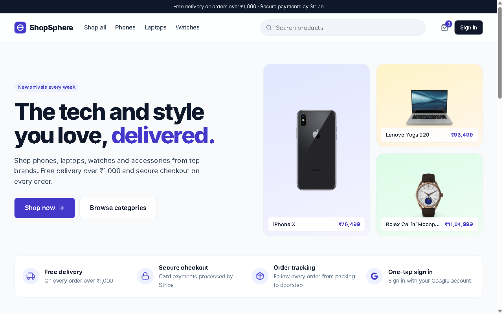
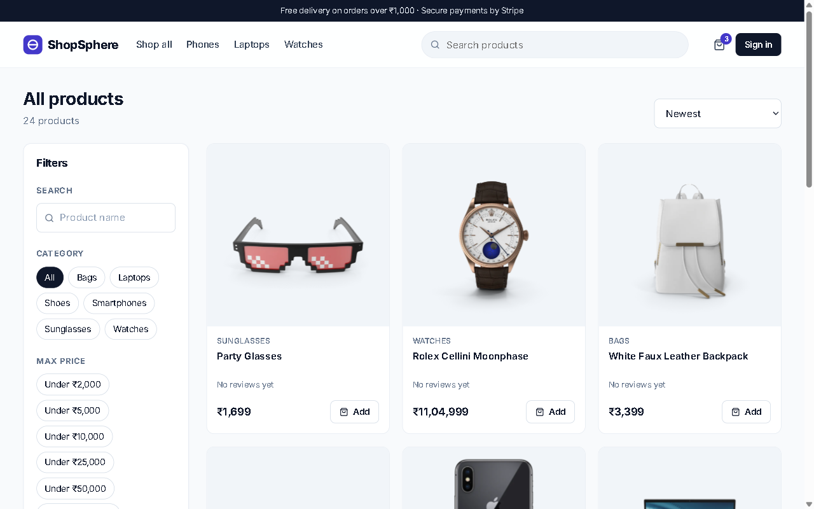
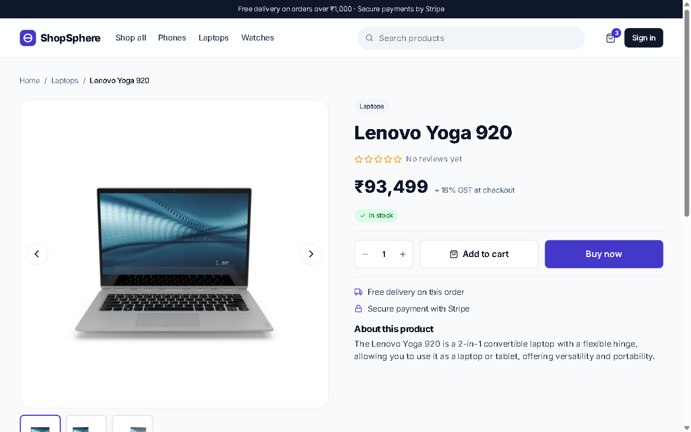
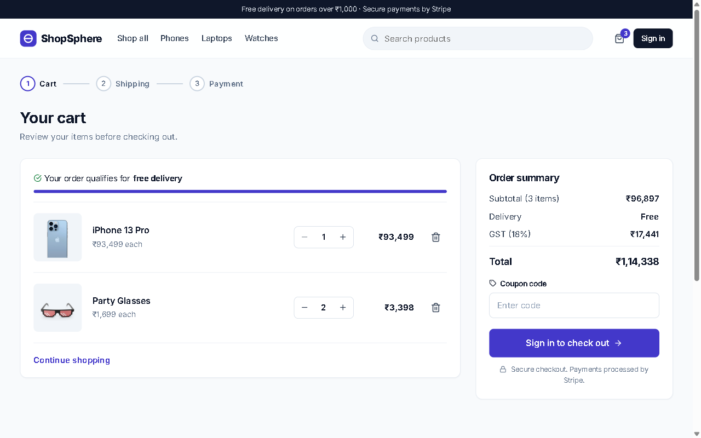
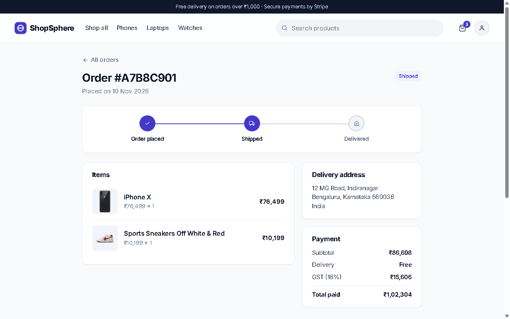

# ShopSphere: MERN e-commerce storefront

[](https://github.com/iyogisharma001/mern-ecommerce-frontend/actions/workflows/ci.yml)


A responsive online store for gadgets and accessories: browse and filter products, sign in with Google, pay with Stripe, and track orders. Admins get a dashboard with sales analytics and product, order, customer and coupon management.

**[Live demo](https://mern-ecommerce-frontend-eight-psi.vercel.app)** · **[Backend API repo](https://github.com/iyogisharma001/mern-ecommerce-backend)**

> Payments run in **Stripe test mode**: use card `4242 4242 4242 4242`, any future date and any CVC.

Built by **Yogesh Sharma** ([GitHub](https://github.com/iyogisharma001) · [LinkedIn](https://www.linkedin.com/in/yogesh-sharma-597466325/)).



## Features

**Shopping**
- Home page with new arrivals, category tiles and store perks
- Shop page with search, category and price filters, sorting and pagination. Every filter lives in the URL, so links can be shared and the back button restores them
- Product pages with a photo gallery, stock status, quantity picker, "Buy now" and customer reviews
- Cart saved across visits, live coupon check, free-delivery progress bar and an 18% GST breakdown
- Three-step checkout (cart → address → payment) with Stripe Elements and 3-D Secure support
- Order history with status badges, and an order page with a delivery tracker

**Accounts**
- One-click Google sign-in for returning customers; new customers complete a short profile once
- After sign-in, customers land back where they started (for example, checkout)

**Admin dashboard**
- Revenue, orders, products and users with month-over-month change
- Bar, pie and line charts (Chart.js)
- Product management with multi-photo upload, order processing, customers and coupon management

## Screenshots

| Shop with filters | Product page |
|---|---|
|  |  |

| Cart | Order tracking |
|---|---|
|  |  |

## Tech stack

| Area | Choice |
|---|---|
| UI | React 18, TypeScript, React Router 6, SCSS with a token-based design system, react-icons |
| State and data | Redux Toolkit; RTK Query for API caching and invalidation; cart slice saved to `localStorage` |
| Auth | Firebase Authentication (Google). The ID token is attached to every API request |
| Payments | Stripe Elements (`PaymentElement`), with the amount set by the server |
| Charts | Chart.js via react-chartjs-2 |
| Build and quality | Vite, ESLint, GitHub Actions CI |
| Hosting | Vercel (frontend) · Render (API) |

## Engineering notes

- **Never trust the client with money.** The cart sends only product IDs and quantities; the server prices the order and creates the Stripe PaymentIntent. The totals shown in the browser use the same rules (`src/config.ts`), so what you see is what you pay.
- **Auth on every request.** A shared RTK Query base query and an axios interceptor add `Authorization: Bearer <Firebase ID token>`, which Firebase refreshes automatically.
- **Fast first load.** Every page is lazy-loaded, and React, Redux and Firebase ship as separate long-cached chunks, so no single file is over 200 KB and an app update doesn't re-download the libraries.
- **Loading and empty states.** Skeleton cards while data loads, and helpful empty states for empty carts, no orders or no search results.
- **Accessible by default.** Labelled controls, keyboard-friendly focus styles, `aria` attributes on menus, steppers and ratings, and a page title per route.
- **Responsive.** Built mobile-first, with a slide-in filter drawer on small screens.

## Run it locally

You need the [backend API](https://github.com/iyogisharma001/mern-ecommerce-backend) running (see its README). Then:

```bash
npm install
```

Create `.env.local` (ignored by git) with:

| Variable | Value |
|---|---|
| `VITE_SERVER` | API URL, e.g. `http://localhost:4000` (no trailing slash) |
| `VITE_STRIPE_KEY` | Stripe publishable key `pk_test_...` |
| `VITE_FIREBASE_KEY`, `VITE_AUTH_DOMAIN`, `VITE_PROJECT_ID`, `VITE_STORAGE_BUCKET`, `VITE_MESSAGING_SENDER_ID`, `VITE_APP_ID` | Firebase → Project settings → Your apps → Config |

```bash
npm run dev
```

Open `http://localhost:5173`.

| Command | What it does |
|---|---|
| `npm run dev` | Development server |
| `npm run lint` | ESLint (zero warnings allowed) |
| `npm run build` | Type-check and production build |
| `npm run preview` | Serve the production build |

## Project structure

```
src/
├── App.tsx              # Routes, layout, auth listener
├── config.ts            # Store name, links and pricing rules
├── components/          # Header, footer, product card, gallery, checkout steps, admin UI
├── pages/               # Storefront pages; pages/admin for the dashboard
├── redux/               # RTK Query APIs (product, order, user, dashboard) and slices
├── styles/              # _tokens, _base, _layout, _components, _pages (+ admin styles)
└── utils/               # Formatting, hooks (useAddToCart, useDocumentTitle)
```

## Deployment

Deployed on Vercel. `vercel.json` rewrites every route to `index.html` for client-side routing. Full setup for the frontend, API and services: [DEPLOY.md](https://github.com/iyogisharma001/mern-ecommerce-backend/blob/main/DEPLOY.md).

---

Product photos and descriptions are demo data from [DummyJSON](https://dummyjson.com). ShopSphere is a portfolio project, not a real shop.
